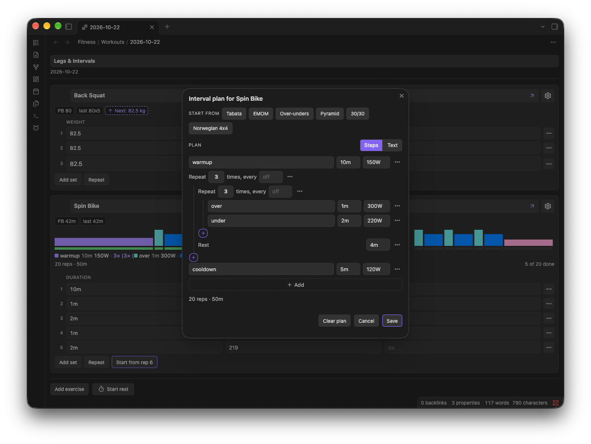
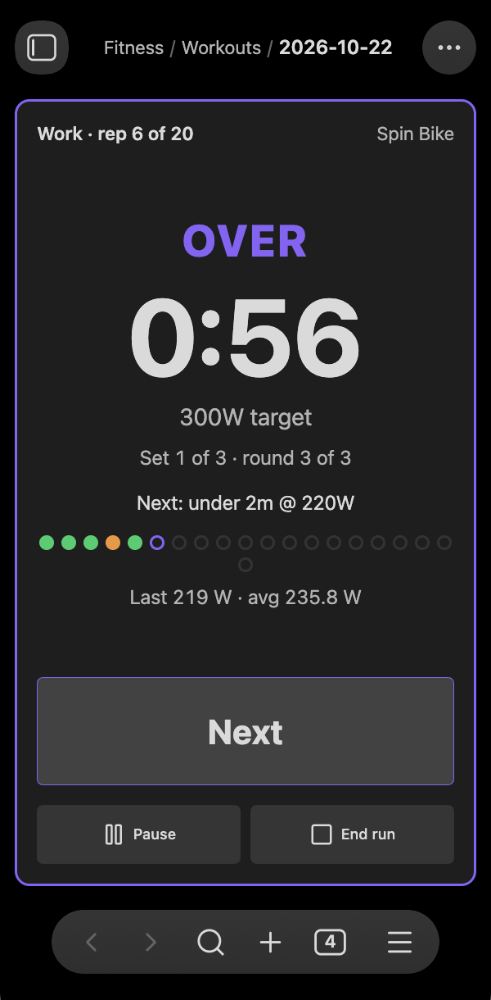

# Interval training

An interval card is a duration exercise with a plan. The plan says what to do and for how long, such as eight rounds of 20 seconds hard and 10 seconds easy, and FitKit times it for you, one full-screen clock per step. Each rep you finish is written to the workout note as its own row, with the time you did and the intensity you held.

This page covers setting a card up, writing a plan, a set of common sessions to start from, what happens when you run one, and looking after an interval exercise from one session to the next.

## Setting up an interval card

Open the card menu on any exercise, choose `Change type...`, then `Switch to interval`. FitKit asks whether the change is for this workout only or for the exercise in general:

- `Just this workout` makes this card an interval card and leaves the exercise as it was everywhere else.
- `Update registry too` also records the exercise as interval (see [Exercise registry](exercise-registry.md#kinds-and-units)), so it starts as an interval card each time you add it.

The plan form opens straight after.

`Rename exercise` gets there too: renaming a card to an exercise already recorded as interval makes it an interval card for this workout and opens the plan form, offering the plan that exercise last ran.

You only set this up once per exercise. Adding an exercise to a later workout starts its card with the plan it last ran, and an exercise recorded as interval with no plan yet opens the plan form as soon as you add it. A session logged without a plan starts the card plain.

To go back, `Switch to duration` under `Change type...` keeps the logged rows and drops only the plan.

## The plan form

The plan form opens from `Switch to interval`, from `Edit interval plan` in the card menu, or by tapping the plan on the card. From top to bottom it holds the presets, the plan itself, a preview, and the `Save` bar.



### Starting from a preset

`Start from` fills the plan with a common session in one tap: Tabata, EMOM, over-unders, a pyramid, 30/30 and Norwegian 4x4. The list is yours to change under `Interval presets` in [Settings](settings.md), and clearing it hides `Start from`.

A preset is a starting point. Change the times and targets to suit you, then `Save`.

### Building a plan from steps

`Steps` shows the plan as rows, one per thing you do:

- A step has a name, a work time, and an optional target. The name is what the runner shows above the clock (`warmup`, `over`, `sprint`), the time is a duration such as `30s`, `2m` or `1:30`, or `open` for work that ends when you tap `Rest`, and the target is watts (`300W`), load (`120kg`) or a level (`L12`).
- A rest has a time, and comes after the step above it.
- A repeat is an indented group with a round count, and holds steps, rests or further repeats. Its `every` field, `off` by default, starts each round on the clock instead (see [EMOM](#emom)).

Two buttons add rows. The `+` at the foot of a repeat's bracket adds a step, rest or repeat to the end of that repeat, and the dashed `Add` bar after the last row adds one to the end of the plan. Each row's menu moves it up or down, duplicates it, puts it in a repeat, ungroups a repeat, or deletes it.

A target field can hold several targets, such as `L8 L10 L12`, and takes the next one each round of the repeat around it. That is how a pyramid or a ladder fits in one row.

Beneath the rows, the preview gives the rep count and total time, such as `13 reps · 24m20s`, or says what is stopping the plan from running. `Save` stays disabled until the plan can run.

### Writing a plan as text

`Text` shows the same plan as one line, written in the plan syntax described [below](#plan-syntax). Switching between `Steps` and `Text` keeps your plan, so you can build it one way and check it the other.

In `Text`, the info button beside `Plan` opens worked examples, each with `Use this` to load it. A plan the rows cannot show, such as an `every` around only part of a repeat, opens in `Text` and says so.

`Clear plan` removes the plan, which leaves the card as a plain duration card with its rows.

## Common sessions

Each of these is written in the plan syntax, so it can be pasted into `Text`, and each builds the same way in `Steps`.

### Tabata

Eight rounds of 20 seconds hard and 10 seconds easy:

```
(x 8 (work 20s 400W) (rest 10s))
```

In `Steps`, this is a repeat of 8 holding a `work` step and a rest. A rest at the end of a repeat goes between its rounds, so the plan ends on the last `work`.

### 30/30

Ten rounds of 30 seconds on and 30 seconds off, with the off half ridden at an easy target:

```
(x 10 (on 30s 350W) (off 30s 150W))
```

Steps with no rest between them run straight on. The runner double-beeps where one step hands over to the next.

### Over-unders

Three sets of three over-unders, with four minutes between sets, a warm-up and a cool-down:

```
(warmup 10m 150W) (x 3 (x 3 (over 1m 300W) (under 2m 220W)) (rest 4m)) (cooldown 5m 120W)
```

In `Steps`, put a repeat of 3 inside another repeat of 3, with the rest in the outer one. The runner shows which set and round you are on.

### Norwegian 4x4

Four rounds of four minutes hard with three minutes of recovery:

```
(warmup 10m 150W) (x 4 (hard 4m 280W) (rest 3m))
```

### Level pyramid

Six one-minute climbs, stepping the level up and back down, with a minute's rest between:

```
(x 6 (climb 1m (L8 L10 L12 L14 L12 L10)) (rest 1m))
```

In `Steps`, type the six levels into one target field.

### EMOM

Every minute on the minute, 40 seconds of work, resting for whatever is left of the minute:

```
(x 10 (every 1m (work 40s 300W)))
```

In `Steps`, set the repeat's `every` to `1m`. The work has to be shorter than the period.

### Open work on the clock

Six sled pushes, one every two minutes, each ending when you tap `Rest`:

```
(x 6 (every 2m (push open 120kg)))
```

Open work needs an `every`, since there is no fixed time to rest after. The row records how long the push took and the rest left in the period.

### Warm-up without a target

A step with no target is timed but not scored:

```
(spin 5m) (x 5 (work 3m 260W) (rest 2m))
```

Its rep dot stays grey, and in a plan with targeted steps its time does not count towards the duration PB.

## Plan syntax

A plan is a run of bracketed lists, played left to right:

| List                      | Meaning                                                                                                                                                                         |
| ------------------------- | ------------------------------------------------------------------------------------------------------------------------------------------------------------------------------- |
| `(over 1m 300W)`          | A step: its name, its work time, then an optional target. Work is a duration (`30s`, `2m`, `1:30`) or `open`, which ends when you tap Rest.                                     |
| `(rest 90s)`              | A rest after the step before it. Steps with no rest between them run straight on, and a rest at the end of the plan is dropped.                                                 |
| `(x 3 …)`                 | Repeats what follows. Repeats nest, and a rest at the end of a repeat goes between its rounds, not after the last.                                                              |
| `(every 2m …)`            | Starts each step inside one period after the last one started, resting for whatever the step left (EMOM). Open work needs it, and timed work has to be shorter than the period. |
| `(climb 1m (L8 L10 L12))` | A list of targets takes the next one each round of the repeat around it.                                                                                                        |

The target is watts (`300W`), load (`120kg`) or a level (`L12`), one kind per plan, and each row records the same field. Quote a name with spaces: `("big gear" 2m 260W)`.

The earlier one-line form still works for a single repeat: `8 x 30s @ 300W, 90s rest` or `6 x open @ 120kg, every 2m`, read as `<reps> x <work> @ <target>, <pace>`.

How a plan and its rows look in the note is in [Note format](note-format.md#interval-plans).

## Reading the card

Once it has a plan, the card shows it above the rows:

- A profile with one bar per step, its width the time and its height the target, each step name in its own colour.
- A strip beneath the profile that turns each logged rep green on target or orange short of it, with a tick where the next rep starts.
- A line that spells the plan out with each step's colour beside its name, such as `10× over 1m6s 300W · under 2m54s 250W · rest 1m`.
- The totals: reps, total time, and how many are done.

Tap any of it to edit the plan. The rows gain intensity and rest columns, and `Add set` and `Repeat` carry both forward, so a session done without the runner can still be logged by hand.

## Running a plan



An interval card swaps the play button for `Start`, which reads `Start from rep N` once some reps are done. A row with no work time and no rest is not done, even with watts or a note typed in it, so the run starts on it and keeps what was typed. `Start` takes over the tab:

- The clock counts the work down (or up, for open work) and then the rest. A named step's name heads the clock, with its target beneath, the set and round when repeats nest, and the step that comes next.
- The big button reads `Rest` while you work, which ends the rep with the time you did. It reads `Next` when the next step follows with no rest, `Finish` on the last step, and `Skip` while you rest, which starts the next rep at once. A phase whose time runs out ends by itself.
- Each finished rep is written to the note straight away with the target filled in. During rest, the minus and plus buttons correct the intensity of the rep you just did, from what the machine's console showed. When the next rep starts with no rest, as with a step that follows the last directly, they show while you work it instead, still correcting the rep before.
- Rep dots go green for reps on target (within 5% of the step's target, held for the full work time; open work counts intensity only), amber otherwise, and grey for a step with no target. The last and average intensity sit beneath them.
- `Pause` banks the time so far, and `End run` returns to the card with the reps you finished. When the plan is done, the runner shows how many reps hit the target.

With `Interval beeps` on (see [Settings](settings.md)), the last three seconds of each interval beep, the change between work and rest has its own tone, and a double beep marks work running straight into the next step. The runner keeps the screen awake where the platform allows. Beeps cannot sound while the phone has Obsidian suspended.

### If Obsidian closes mid-run

A run lives in the note, not in memory, so a phone closing Obsidian in the background does not lose it. Reopening the workout picks the run up from the clock: reps that finished while Obsidian was closed are filled with the target, flagged `logged while Obsidian was closed`, and counted in a notice so you can check them. When several reps were caught up, the editor marks each one with an asterisk by its set number and explains the asterisk once under the sets.

If the plan ended more than two minutes before you came back, FitKit does not make up reps. It shows `Run cut off at rep N` with `Resume rep N` and `End run here`. Closing the tab yourself pauses the run.

## Managing interval exercises

Once an exercise is recorded as interval, most of the work is changing its plan as you get fitter:

- To change the plan, choose `Edit interval plan` in the card menu or tap the plan on the card. The change is saved on this workout's card, and the next workout that adds the exercise starts from it.
- To keep plans you reuse across exercises, add them to `Interval presets` in [Settings](settings.md), one per line as `Label: plan`. They appear under `Start from` in the plan form.
- A long session's rows fold away once they pass half the screen, behind `Show all N sets`, so the card stays short while you work.
- To stop treating an exercise as interval, choose `Switch to duration` under `Change type...` with `Update registry too`. The logged rows stay, and the exercise starts as a plain duration card from then on. The type can also be changed in the [Exercise registry](exercise-registry.md#kinds-and-units).
- To rename an interval exercise everywhere, use the registry, as for any other exercise (see [Exercise registry](exercise-registry.md#renaming-an-exercise)). `Rename exercise` on the card changes only this workout.

Interval reps count towards the exercise's duration PB and charts like any duration row, leaving out untargeted steps such as a warm-up when the plan has targeted ones (see [Dashboard and charts](dashboard-and-charts.md)).

### Planning the next session

The card menu records which way to take the plan next session: `Plan: increase`, `Plan: keep` or `Plan: decrease`, written as `[next:: up]` and shown as the `Next` badge. An interval card takes the direction alone, with no step size, since each step of the plan has its own target; keep reads `Same target`. See [Workout editor](workout-editor.md#planning-your-next-session).

## Going back to an older FitKit

A version of FitKit from before interval training reads a mid-run rep as a running stopwatch, and drops the intensity, rest and plan fields on its next save. Finish or end a run before switching back to an older version. An exercise recorded as interval reads as an ordinary duration exercise there, with its history, charts and PBs intact.
