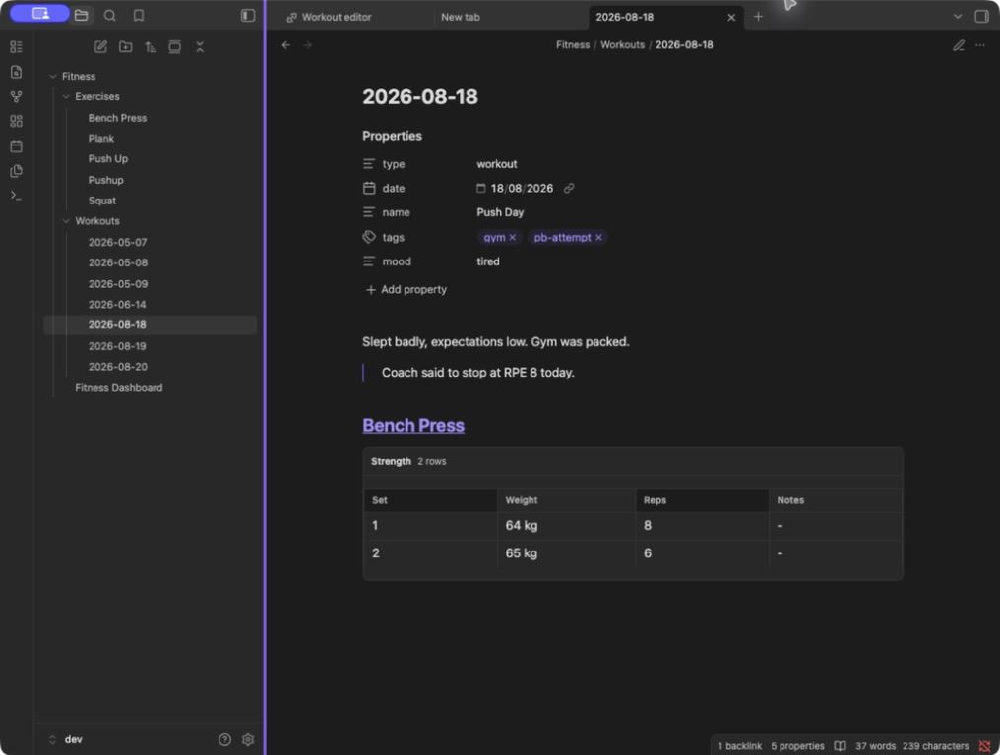

# Note format

Everything FitKit stores is a normal Markdown note. This page describes the shapes it reads and writes, so you can hand-edit with confidence or query your training data with your own Dataview queries.

## Workout notes

A note is a workout when its frontmatter carries `type: workout`. FitKit also writes `date:` and `name:`.

```markdown
---
type: workout
date: 2026-05-12
name: Squat Day
tags:
  - gym
---

## [[Squat]]

- [exercise:: [[Squat]]] [notes:: felt heavy] [next:: up 2.5]
- [exercise:: [[Squat]]] [set:: 1] [weight:: 50] [reps:: 5]
- [exercise:: [[Squat]]] [set:: 2] [weight:: 55] [reps:: 5]

## [[Plank]]

- [exercise:: [[Plank]]] [duration:: 60]

## [[Push Up]]

- [exercise:: [[Push Up]]] [notes:: elbows in]
- [exercise:: [[Push Up]]] [set:: 1] [level:: 2] [reps:: 8]
- [exercise:: [[Push Up]]] [set:: 2] [level:: 2] [reps:: 6] [load:: 10]
```

Dataview inline fields are the canonical format. The recognised ones are:

| Field      | Meaning                                                                                                               |
| ---------- | --------------------------------------------------------------------------------------------------------------------- |
| `exercise` | Wikilink to the exercise. Required on every row.                                                                      |
| `set`      | Set number within the exercise.                                                                                       |
| `weight`   | Weight lifted, in the exercise's unit.                                                                                |
| `reps`     | Repetitions.                                                                                                          |
| `duration` | Seconds. Always seconds, whatever you typed into the editor.                                                          |
| `started`  | Local time a duration timer started, such as `2026-09-30T07:15:03+10:00`. Present only while that timer runs.         |
| `level`    | Rung reached, as a 1-based position in the exercise's `levels:` ladder.                                               |
| `load`     | Added weight on a bodyweight set, such as a vest.                                                                     |
| `notes`    | Free text, on an exercise header row or on an individual set.                                                         |
| `next`     | `up`, `down`, or `stay`, with an optional step (`up 2.5`): a weight change for strength, a rung count for bodyweight. |
| `plan`     | An interval plan on a duration exercise's header row, such as `(x 8 (work 30s 300W) (rest 90s))` (see below).         |
| `step`     | The plan step an interval row ran, such as `over`.                                                                    |
| `watts`    | Power held on an interval rep.                                                                                        |
| `rest`     | Seconds rested after an interval rep. The last rep of a run has none.                                                 |
| `paused`   | `true` on the open rep of a paused interval run.                                                                      |

### Interval plans

A duration exercise can carry a plan on its header row, and each work step is then one row:

```markdown
## [[Indoor Bike]]

- [exercise:: [[Indoor Bike]]] [plan:: (warmup 10m 150W) (x 3 (over 1m 300W) (under 2m 220W)) (cooldown 5m 120W)]
- [exercise:: [[Indoor Bike]]] [set:: 1] [step:: warmup] [duration:: 600] [watts:: 152]
- [exercise:: [[Indoor Bike]]] [set:: 2] [step:: over] [duration:: 60] [watts:: 304]
- [exercise:: [[Indoor Bike]]] [set:: 3] [step:: under] [duration:: 120] [watts:: 221]

## [[Sled Push]]

- [exercise:: [[Sled Push]]] [plan:: (x 6 (every 2m (push open 120kg)))]
- [exercise:: [[Sled Push]]] [set:: 1] [step:: push] [duration:: 18] [load:: 120] [rest:: 102]
```

A plan is a run of bracketed lists, played left to right:

| List                      | Meaning                                                                                                                                                                         |
| ------------------------- | ------------------------------------------------------------------------------------------------------------------------------------------------------------------------------- |
| `(over 1m 300W)`          | A step: its name, its work time, then an optional target. Work is a duration (`30s`, `2m`, `1:30`) or `open`, which ends when you tap Rest.                                     |
| `(rest 90s)`              | A rest after the step before it. Steps with no rest between them run straight on, and a rest at the end of the plan is dropped.                                                 |
| `(x 3 …)`                 | Repeats what follows. Repeats nest, and a rest at the end of a repeat goes between its rounds, not after the last.                                                              |
| `(every 2m …)`            | Starts each step inside one period after the last one started, resting for whatever the step left (EMOM). Open work needs it, and timed work has to be shorter than the period. |
| `(climb 1m (L8 L10 L12))` | A list of targets takes the next one each round of the repeat around it.                                                                                                        |

The target is watts (`300W`), load (`120kg`) or a level (`L12`), one kind per plan, and each row records the same field. A step with no target, such as `(spin 5m)`, is timed but not scored, and its time does not count towards the duration PB. Quote a name with spaces: `("big gear" 2m 260W)`.

Some sessions written out:

- Tabata: `(x 8 (work 20s 400W) (rest 10s))`
- 30/30 with no rest between steps: `(x 10 (on 30s 350W) (off 30s 150W))`
- Three sets of over-unders: `(warmup 10m 150W) (x 3 (x 3 (over 1m 300W) (under 2m 220W)) (rest 4m)) (cooldown 5m 120W)`
- A level pyramid: `(x 6 (climb 1m (L8 L10 L12 L14 L12 L10)) (rest 1m))`
- EMOM: `(x 10 (every 1m (work 40s 300W)))`

The earlier one-line form still works for a single repeat: `8 x 30s @ 300W, 90s rest` or `6 x open @ 120kg, every 2m`, read as `<reps> x <work> @ <target>, <pace>`.

While a run is under way, its open rep carries a `started` stamp, which times the rest when the row has a `rest` field and the work otherwise. That stamp, the plan and the rows are the run's whole state, which is how a run survives Obsidian being closed.

An `## [[Name]]` heading groups the rows beneath it. FitKit treats an H2 as an exercise heading only when the section it introduces contains at least one logged exercise row, which is what lets a `## Session notes` heading sit in a workout note without being mistaken for an exercise.

Fenced code blocks in a workout note are reporting surfaces, not the source of truth.

## What survives a save

The workout editor autosaves by parsing the note and writing it back, so anything the parser does not model would be at risk. It is deliberately conservative:

- Frontmatter keys other than `type`, `date`, and `name` are re-emitted verbatim, including indented continuation lines such as YAML list items.
- Prose, blockquotes, task checkboxes, non-exercise bullets, nested sub-bullets, embeds, tables, and sub-headings are captured at parse time and restored in position.
- Preserved content is anchored to the exercise and row it followed rather than to a line offset, so it lands in the right place and stays put across repeated saves.
- A section heading that is not an exercise heading survives.
- A fenced code block keeps its position and the blank lines either side of it.

The one documented exception is inline fields FitKit does not recognise. `[rpe:: 7]` on an exercise row is dropped the next time the editor saves that note. A `[next:: ...]` value it cannot read is a special case: it is ignored rather than reported, and rewritten to nothing on save like any other unrecognised field.

## Exercise notes

An exercise note is a Markdown file in your exercises folder with `type: exercise` frontmatter. The filename is the display name.

````markdown
---
type: exercise
kind: strength
unit: kg
metric: e1rm
---

## Progress chart

```fitkit-chart
exercise: Squat
```

## Recent sessions

<!-- generated Dataview query -->

## Notes

Your own training notes live here.
````

`kind:` is `strength`, `duration`, or `bodyweight`. `unit:` is `kg` or `lbs` and applies to strength exercises only, as does `metric:`, which selects what the progress chart plots. A bodyweight note carries neither; it carries a `levels:` ladder instead, see [Dashboard and charts](dashboard-and-charts.md#chart-blocks).

FitKit seeds the three sections when it creates a note, and `Sync and repair exercise notes` refreshes them in notes you already have. The `Notes` section is yours; nothing regenerates over it.

A bodyweight note declares its ladder instead of a unit and a metric:

```markdown
---
type: exercise
kind: bodyweight
levels:
  - Incline push-up
  - Push-up
  - Archer push-up
---
```

The `levels:` list names the rungs in the author's order, and a set row's `[level:: N]` is a 1-based position in it. A level the ladder no longer names displays as `Level N`, so renaming or shortening the ladder never orphans a logged set. An exercise with no note of its own can carry its ladder on its registry entry instead, see [Exercise registry](exercise-registry.md#kinds-and-units).

## Reading mode

With the workout editor turned off, or on a note you opened as Markdown, FitKit renders recognised exercise rows as a table in reading mode. Everything else in the note renders as ordinary Markdown.



The screenshot doubles as a picture of the save guarantees above: the `tags` and `mood` frontmatter keys, the paragraph, and the blockquote are all hand-written, and all of them survive a round trip through the editor.

## The dashboard

`Fitness/Fitness Dashboard.md` is generated in full on every rebuild. Treat it as output, not as a note to edit, because your changes will be overwritten. See [Dashboard and charts](dashboard-and-charts.md).
