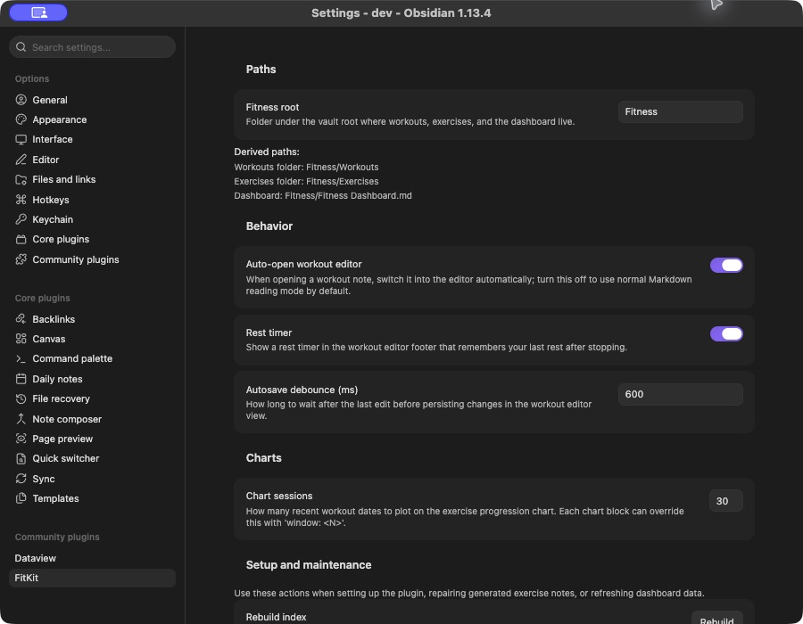
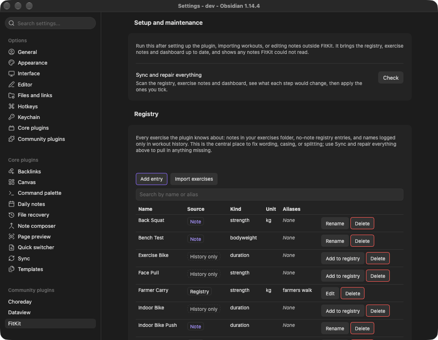
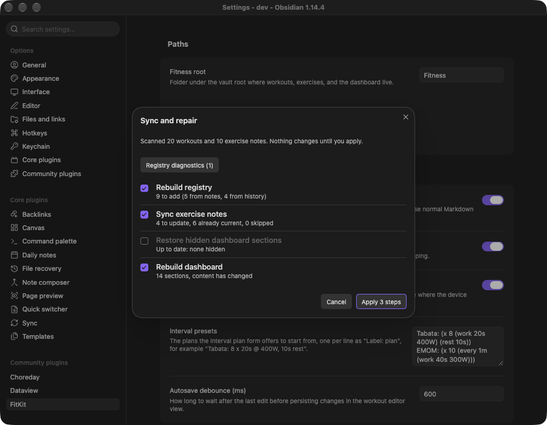

# Settings and maintenance

FitKit works out of the box. Nothing here needs configuring before you log your first workout.

## Paths

`Fitness root` is the only path you set. Everything else is derived from it and shown underneath as you type:

- `Fitness/Workouts/` for workout notes, one per date.
- `Fitness/Exercises/` for exercise notes.
- `Fitness/Fitness Dashboard.md` for the generated dashboard.

Changing the root does not move existing files. Move them yourself first, then point the setting at the new location.

## Behaviour

- `Auto-open workout editor` switches a `type: workout` note into the structured editor when you open it. Turn it off to land in Markdown by default and open the editor deliberately from the command palette.
- `Rest timer` shows the rest timer in the editor footer. It counts up from zero and remembers your last rest after you stop it.
- `Interval beeps` beeps the last three seconds of each interval and the change between work and rest in the interval runner, and vibrates where the device can.
- `Interval presets` lists the plans the interval plan form offers under `Start from`, one per line as `Label: plan` (for example `Tabata: (x 8 (work 20s 400W) (rest 10s))`). It starts with Tabata, EMOM, Over-unders, Pyramid, 30/30 and Norwegian 4x4, and a list still holding the first betas' Tabata and EMOM moves to these. A line whose plan cannot run is flagged and left out, and clearing the box hides `Start from`.
- `Interval stepper step` is how far the interval runner's minus and plus move a rep. A percentage such as `10%`, the default, is taken of the rep's target (or what it logged, when its step has none) and rounded to whole watts, half kilograms or whole levels, and never less than one of those units. A plain number such as `5` moves every rep by that amount in the plan's own unit. An entry that is neither is refused, and the last good step stays. A plan with its own `adjust` uses that instead (see [Interval training](interval-training.md#plan-syntax)).
- `Autosave debounce (ms)` is how long the editor waits after your last edit before writing. It defaults to 600, and anything below zero or unparseable resets to that.

## Charts

`Chart sessions` is how many recent workout dates a progression chart plots, defaulting to 30 and clamped between 5 and 365. Any individual chart block can override it with `window: <N>`, see [Dashboard and charts](dashboard-and-charts.md#chart-blocks).

## Setup and maintenance

`Sync and repair everything` is the one maintenance action. `Check` scans the vault without writing anything and opens a dialog that says what each step would change:

| Step                                | What it does                                                                                                  |
| ----------------------------------- | ------------------------------------------------------------------------------------------------------------- |
| `Rebuild registry`                  | Adds every exercise note and history-only name missing from the registry. Never overwrites an existing entry. |
| `Sync exercise notes`               | Refreshes frontmatter, chart blocks, `Recent sessions`, and headings in existing exercise notes.              |
| `Restore hidden dashboard sections` | Clears hidden-section state for the dashboard and regenerates it.                                             |
| `Rebuild dashboard`                 | Rescans workout notes, then regenerates the dashboard note in full.                                           |

Steps with nothing to change start unticked and say `Up to date`, but you can tick any of them. `Apply` runs the ticked steps in the order above, because syncing notes reads the registry and the dashboard reads everything, then lists each step's result. A step that fails stops the ones after it.

When the scan finds workout notes FitKit could not read, or exercise notes whose `kind:` is missing or disagrees with the registry, the dialog offers `Parse diagnostics` and `Registry diagnostics` buttons that list them.

None of the steps rewrite your workout history.

## Registry

The registry table sits below Setup and maintenance and has its own page, see [Exercise registry](exercise-registry.md).

## Commands

The command palette is kept to daily workout entry:

| Command                                | What it does                                                         |
| -------------------------------------- | -------------------------------------------------------------------- |
| `Open today's workout`                 | Creates today's workout note if needed, then opens it in the editor. |
| `Open workout editor for current file` | Opens the active Markdown file in the editor.                        |

Both are assignable to hotkeys through Obsidian's own hotkey settings.
