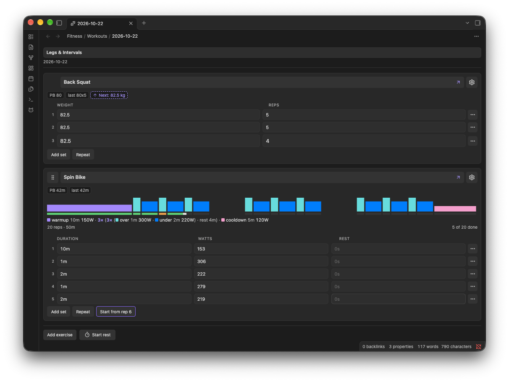

# Workout editor

The workout editor is a structured form that replaces Obsidian's Markdown view for workout notes. It reads and writes the same note you would otherwise edit by hand, so nothing is locked away behind it.

## Opening it

A note counts as a workout when its frontmatter has `type: workout`. With `Auto-open workout editor` on (the default), opening one of those notes switches straight into the editor. Turn the setting off if you would rather open in Markdown and open the editor deliberately.

Two commands are in the palette:

- `Open today's workout` creates `Fitness/Workouts/<today>.md` if it does not exist, then opens it in the editor.
- `Open workout editor for current file` opens whatever Markdown file is active.

The second command works on any Markdown file, so it is also how you convert an existing note.

## Adding an exercise

`Add exercise` in the footer suggests names FitKit already knows about. Pick an existing one and the card takes its kind from the registry. Type a new one and FitKit asks whether to create an exercise note for it.

Leave `Create exercise note` ticked for anything you want to chart and revisit; the note is what gives the exercise a progression chart, a `Recent sessions` table, and a home for your own notes. Untick it and you get a no-note registry entry instead. Both paths register the name, so it appears in the registry table. `Skip` registers nothing and leaves the exercise living only in workout history.

## The exercise card

Each exercise gets a card. The header holds the name and the card menu, plus a drag handle on the left that appears when you hover the card or reach it with the keyboard. On a touch device or a narrow pane the handle is always visible.

The card menu covers `Open exercise file`, `Rename exercise`, `Add exercise note` / `Edit exercise note`, the plan items described under [Planning your next session](#planning-your-next-session), `Switch to ...` for the other two kinds, `Move up`, `Move down`, and `Remove exercise`.

`Rename exercise` is scoped to this workout: it points the card at a different exercise. It suggests names already in your exercises folder or workout history, and if the name you pick is a different kind it asks before switching the card over. To rename an exercise everywhere, use the registry instead, see [Exercise registry](exercise-registry.md#renaming-an-exercise).

Under the header sit the history badges:

- `PB` is the heaviest weight lifted for a strength exercise, the longest session total for a duration one, or the highest rung reached for a bodyweight one. It is a real lift, not an estimated 1RM.
- `last` is the same measure taken from the most recent prior session.
- `Next` shows the plan in force, and resolves the weight where it can (`Next: 22.5 kg`, or the rung for a bodyweight exercise). A plan you set on this card wins over the one carried in from last session, so the badge reflects your choice as soon as you make it.

Badges are terse so several fit one line on a phone; hover one for the full sentence and its date. `PB` and `last` only appear once there is history to draw on, so a brand new exercise starts bare.

An exercise note is added from the card menu and renders as a line under the badges once one exists; click the line to edit it. It persists as a `[notes:: ...]` field on a header row for that exercise.

## Logging sets

Strength cards give you a `Set` figure, a `Weight` field and a `Reps` field per set. The set figure shows the number stored in the note rather than a running count, so a hand-edited `1, 3, 7` stays as you wrote it; `Renumber sets` in the row menu resequences from 1 when you want it tidied. `Add set` appends a row carrying the previous set's weight, with reps left empty. `Repeat` beside it appends a copy of the last set's weight and reps, leaving its note behind; it stays disabled until the card has a set. The kebab on each row holds `Edit note`, `Renumber sets` and `Delete row`; a saved row note renders under the row and reopens the editor when clicked.

The last row of a strength card is the one you are logging, so its fields are drawn larger than the finished rows above them, and larger again on a phone or a narrow pane.

The first set of a new card prefills its weight from the plan you recorded for that exercise last session, applied to that session's top set. A proposed weight is drawn dashed until you type over it. Reps are never prefilled: weight is what you choose before a set, reps are what you count after it. A row holding a weight and no reps counts for nothing until you record them, so it cannot become a personal best or move your history while the set is still in progress.

Duration cards work the same way, swapping weight and reps for a single `Duration` field, with `Add set`, `Repeat` (which copies the last duration) and `Start timer` beside them. Their set numbers are figures too, resequenced from the same `Renumber sets` item. The field accepts three shapes:

- Bare seconds, `90`.
- Unit form, `1m30s` or `2h`.
- Clock form, `1:30` or `1:00:30`.

Whatever you type is normalised to the unit form on blur, and stored in the note as seconds.

`Start timer` takes over the tab with a big clock that counts the last set up from whatever time it already holds (or adds a set when the card has none), and keeps the screen awake where the platform allows. Everything a stretch session needs is on that screen, so you never have to go back to the card between sets:

- `Stop` writes the time into the set and leaves the screen open, marked `Stopped`.
- `Next set` adds a set and starts timing it at once, whether the clock is running or stopped. The time of the set before shows beneath the clock.
- `Resume` carries on adding to a stopped set, and `Reset` clears the set's time and times it again from zero.
- `Done` stops the clock, writes the time, and returns to the workout where you left it.

While the timer runs, the row also records when it started (`[started:: ...]`), so a timer cut off by the phone closing Obsidian in the background picks up where it left off, timer screen and all, the next time the workout opens. Stopping the timer, or closing the tab yourself, adds the elapsed time to the duration and removes the start time.

Bodyweight cards show `Set`, `Level` and `Reps` per set, with a `Load` cell that appears only while some row in that exercise carries a load. The kebab on each row adds load to that row or removes it again.

Each row carries a level stepper: minus and plus move one rung, stopping at the first and last rung of the ladder. The level label between them opens a menu of every rung, marking the current one. `Add set` copies the previous row's rung and puts the cursor in `Reps`; `Repeat` copies the whole row, rung, reps and load.

The card menu holds `Edit levels`, which edits the ladder one rung per line. An edit that changes what an already-logged level means lists each affected level with its old and new rung, and applies only once confirmed. Appending a rung at the end changes nothing logged and does not prompt.

A rung name too long for its cell shortens to a compact form (`L2`), and grows back into the full name when the cell has room again.

## Interval training

`Switch to interval` in any card's menu sits beside the other types and opens the plan form. Under `Steps` each step is a row with a name, a time (or `open`) and an optional target, each rest is a row, and each repeat is an indented group with its round count and an optional `every` that starts each round on the clock. `+ Step`, `+ Rest` and `+ Repeat` add to the end of a list, and each row's menu moves it, duplicates it, puts it in a repeat, ungroups a repeat or deletes it. Several targets in one field, such as `L8 L10 L12`, take one per round. `Text` shows the same plan as one text field, such as `(warmup 10m 150W) (x 3 (over 1m 300W) (under 2m 220W))` (the syntax is in [Note format](note-format.md#interval-plans)); a plan the rows cannot show opens there and says so. Beneath the plan a preview gives the rep count and total time, or explains a plan that cannot run. The info button beside `Plan` opens worked examples, each with `Use this`, and a link to the full syntax. Presets under `Start from` (Tabata, EMOM, over-unders, a pyramid, 30/30 and Norwegian 4x4, editable in [Settings](settings.md)) fill the field in one tap. The plan shows above the rows (tap it, or `Edit interval plan` in the menu, to change it), the rows gain intensity and rest columns, and `Add set` and `Repeat` carry both forward. An interval exercise is stored as a duration exercise with a plan, so `Switch to duration` keeps the rows and drops only the plan, and choosing `Update registry too` when switching records the exercise as duration. Adding a duration exercise whose last session ran a plan starts the card with that plan, and the plan form on a card without one starts from it too; a last session logged without a plan starts the card plain.

An interval card swaps the play button for `Start`, which reads `Start from rep N` once some reps are done. A row with no work time and no rest is not done, even with watts or a note typed in it, and the run starts on it keeping what was typed. Start takes over the tab:

- The clock counts the work down (or up, for open work) and then the rest. A named step's name heads the clock, with its target beneath, the set and round when repeats nest, and the step that comes next.
- The big button reads `Rest` while you work, ending the rep with the time you actually did, `Next` when the next step follows with no rest, `Finish` on the last step, and `Skip` while you rest, starting the next rep at once. A phase whose time runs out ends by itself. Each row records the step it ran as `[step::]`.
- Each finished rep is written to the note straight away with the target filled in. During rest, the minus and plus buttons correct the rep you just did, from the machine's console.
- Rep dots go green for reps on target (within 5% of the step's target, held for the full work time; open work counts intensity only), amber otherwise, and grey for a step with no target, with the last and average intensity beneath them.
- `Pause` banks the time so far, and `End run` returns to the card with the reps you finished. When the plan is done, the runner shows how many reps hit the target.

With `Interval beeps` on (see [Settings](settings.md)), the last three seconds of each interval beep, the change between work and rest has its own tone, and a double beep marks work running straight into the next step, and the runner keeps the screen awake where the platform allows. Beeps cannot sound while the phone has Obsidian suspended.

A run lives in the note, not in memory. Reopening a workout mid-run picks it up from the clock: reps that finished while Obsidian was closed are filled with the target, flagged `logged while Obsidian was closed`, and counted in a notice so you can check them. If the plan ended more than two minutes before you came back, FitKit does not invent reps; it shows `Run cut off at rep N` with `Resume rep N` and `End run here`. Closing the tab yourself pauses the run.

A version of FitKit from before interval training reads a mid-run rep as a running stopwatch and drops the intensity, rest and plan fields on its next save, so finish or end a run before switching back to an older version.

## Planning your next session

The card menu records how you want to load the exercise next session: `Plan: increase`, `Plan: keep`, or `Plan: decrease`. Choosing the direction that is already set clears it. With increase or decrease chosen, `Set plan step...` takes the step; it stays greyed out until there is a direction to attach a step to. An interval card offers the three directions without a step, since each step of its plan has its own target; keep reads `Same target`.

This is a note to yourself, not an instruction the plugin acts on. It is written as `[next:: up 2.5]`, surfaces as the `Next` badge on the card straight away and again the next time that exercise comes up, and is listed under `Next session plans` on the dashboard. The step is a weight change for a strength exercise and a rung count for a bodyweight one. A `[next:: ...]` value that does not start with `up`, `down`, or `stay` is ignored rather than reported, and is dropped the next time the note is saved.

## Rest timer

The footer holds a rest timer. `Start rest` takes over the tab with a big clock counting up from zero, kept awake like the interval runner, and `Stop rest` returns to the workout where you left it, with `Last rest 90s` beside the button. You start and stop it yourself; it never starts on its own, since only you know whether the set is over. It is a live aid only; rest is not written into the note. Turn it off under `Rest timer` in settings if you time rests elsewhere.

The timer on a duration card is a separate thing, and that one does write into the duration field.

## Switching an exercise between kinds

Switching kind from the card menu asks what you want it to apply to, because the two stores can disagree. `Just this workout` changes the card and its rows here. `Update registry too` also writes the exercise note's `kind:` frontmatter (or the registry entry when there is no note), so new cards for that exercise default to the new kind.

Existing rows of the old kind are cleared by the switch, and the dialog says so before you commit.

Switching to bodyweight seeds a single rung named after the exercise when the switch updates the registry, so the level menu works straight away. It then offers to mark the already-logged sets as the first level, saying how many would change. Declining leaves the cleared card alone. A logged strength weight carries across as load, and reps carry too.

## Saving

The editor autosaves after you stop typing. `Autosave debounce (ms)` controls the wait, defaulting to 600. The header shows `unsaved` between the edit and the write.

If the file changes on disk while the editor has it open, a banner appears: `File changed on disk. Reload to pick up external edits before continuing.` Reloading discards the editor's in-memory state in favour of the file. There is no automatic merge, so the safe move with a synced vault is to reload before editing further.

## Reading mode

With the editor turned off, or on a note you opened as Markdown, FitKit still renders recognised exercise rows as a table in reading mode. See [Note format](note-format.md#reading-mode) for what that looks like and what it leaves alone.
